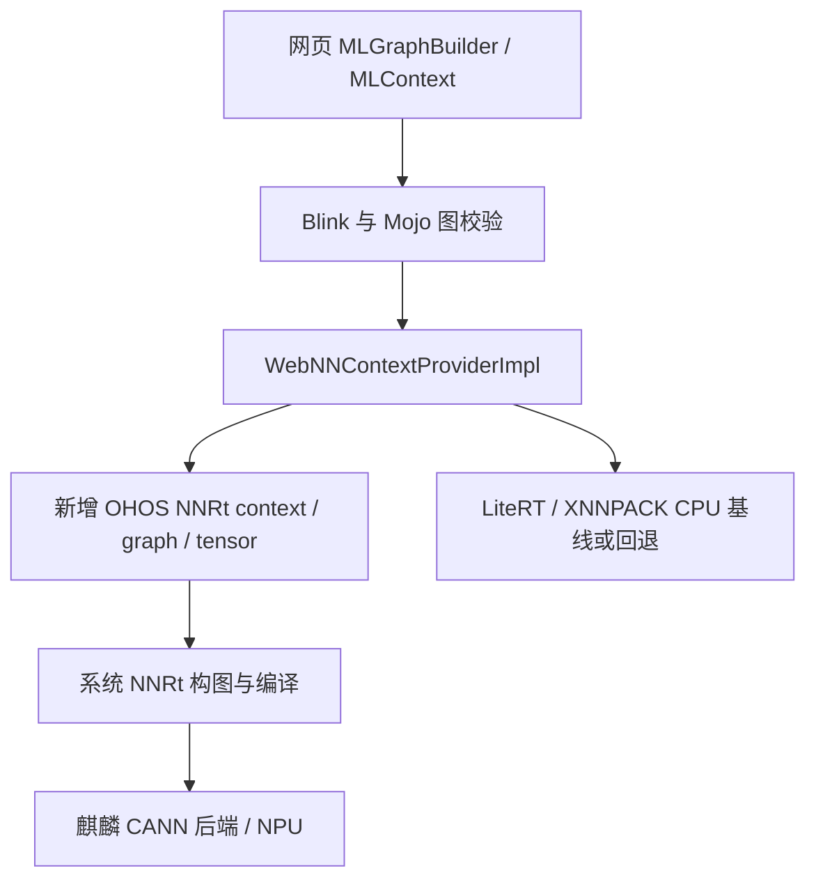

# OHOS WebNN 接入调研（2026-10-19）

## 实施更新

已编写默认关闭的单 Add 原型：`overlay/services/webnn/ohos/`、
`patches/ohos-webnn-nnrt.patch`，以及 Lumie 的独立实验开关。
支持范围、构建方式和待执行验收见 [验证说明](../tools/webnn/README.md)。
原生探针 ARM64 交叉编译/链接通过，主机 SDK 边界故障注入测试通过；
完整 Chromium 原生 CI 与设备验证状态另行记录，不能由探针通过推断。
以下保留调研阶段的判断与后续扩展路线。

## 结论

可以接。若目标是让网页通过标准 WebNN 使用麒麟 NPU，优先方案是新增
Chromium WebNN 的 OHOS/NNRt 后端，保留 Blink API、Mojo 图校验和现有张量生命周期。
这是一个独立推理后端的适配工作，不能通过开启 flag 完成。

若目标是先支持网页推理，现有 LiteRT/XNNPACK CPU 路线可作为第一阶段和数值基线；
LiteRT/WebGPU 是可调查的 GPU 路线，但仍需 OHOS 构建、加速库打包和运行验证。
这些路线均不会自动加速网页排版、TreesInViz、视频解码或 HDR/P3 输出。

本次仅调研代码与 SDK/官方文档，没有启动手机测试、修改运行设置、实现后端或进行原生构建。

## 已确认的现状

- 仓库固定 Chromium revision：`b510e9d7cd3a2fbd78d0ddc42234103206c5f78d`。
- 现有 overlay/patch 没有 OHOS WebNN 后端实现。
- `services/webnn/features.gni` 的 `webnn_use_tflite`、`webnn_use_litert`
  默认只列出 Android/ChromeOS/Linux/Apple/Windows，没有 OHOS。
  本仓库 GN 中 `is_linux` 与 `is_ohos` 是独立条件。
- `config/args.plan_kirin_pc.gn` 已有 `build_with_tflite_lib = true`，但这不是
  WebNN 后端开关；现有配置没有覆盖上述两个 WebNN 参数。
- `WebMachineLearningNeuralNetwork` 上游 feature 默认关闭。
  先前保存的手机 `gpu-on.json` 中 WebNN 为 `disabled_off`，即使 WebGPU 已 enabled、
  Skia 已为 GraphiteDawnVulkan。这里只复用了已有报告，没有重新操作手机。
- `ML::createContext()` 通过 Mojo 连接 WebNN context provider，包含 WebNN
  Permissions Policy 检查。网页框架需要显式选择/使用 WebNN，现有网页不会自动切换。
- **重要：**固定版本的 `WebNNContextProviderInRenderer::CreateWebNNContext()`
  会把非 GPU 请求（含 NPU）强制改成 CPU。只启用 LiteRT 后，
  `navigator.ml.createContext({deviceType: 'npu'})` 成功不构成 NPU 执行证据。
- LiteRT GPU 路线使用 Dawn/WebGPU；现有 Graphite 使用 Dawn 并不等于 LiteRT
  的加速插件、设备创建或推理路径已接通。`ContextImplLiteRt` 的 WebGPU tensor
  import 还有明确的“不支持 WebGPU Interop”返回，不能顺带承诺零拷贝互操作。

## 路线比较

| 路线 | 能得到什么 | 额外工作与判断 |
| --- | --- | --- |
| 上游 LiteRT + XNNPACK | WebNN CPU 执行和数值对照基线 | 开启 OHOS 构建参数，处理依赖/链接/线程与权重文件路径，完成构图和 dispatch 验证；不能算 NPU |
| 上游 LiteRT + WebGPU | GPU 推理候选 | 额外处理 LiteRT WebGPU accelerator 的产物、预加载、Dawn 设备/队列及进程模式；是否优于 CPU 未知 |
| 新增 WebNN → NNRt 后端 | 网页标准 API 对接系统 AI 加速硬件 | 推荐的 NPU 方向；需图转换、设备能力、张量、调度、错误和生命周期适配 |
| WebNN → MindSpore Lite → NNRt | 利用系统框架的多后端/异构能力 | 仍需把网页即时构建的图转为框架模型；加载已有 MindIR 很方便，但不省掉通用 WebNN 图转换 |
| 直接接 CANN Kit | 麒麟特有调优、单算子或专用模型 | 更强的厂商耦合；通用 WebNN 第一版优先 NNRt。CANN 已是麒麟的 NNRt 后端 |

WebNN 并不是 ONNX/MindIR/OM 文件加载接口。网页端框架负责把模型转为 WebNN 图；
离线把自有模型转成 OM、在 Lumie 原生侧运行，是另一种产品能力，不能替代任意网站的 WebNN。

## 推荐接入结构

建议新增 `services/webnn/ohos/` 的 context、graph builder、graph、tensor、NNRt
API wrapper，接入 `services/webnn/BUILD.gn` 和 provider 的平台选择。
这些是建议文件位置，目前没有创建实现。

- **设备选择**：用 `OH_NNDevice_GetAllDevicesID/GetType/GetName` 枚举，选择实际
  NPU 设备，调用 `OH_NNCompilation_SetDevice`；无设备时报告不支持。
  实验验收不要把 CPU 回退结果标成 NPU。
- **构图**：从已校验的 WebNN GraphInfo 映射 operand/constant/operation，使用
  `OH_NNModel_AddTensorToModel`、`SetTensorData`、`AddOperation`、
  `SpecifyInputsAndOutputs`、`Finish`；通过 `GetAvailableOperations` 查询具体图支持情况。
- **语义适配**：重点核对广播、维度/布局、padding、axis、量化参数和精度。
  同名算子不是语义等价保证。`opSupportLimits()` 应只声明实现且验证过的类型/形状范围。
  第一版不支持的图明确返回错误；自动切子图与 CPU/NPU 混合执行另行设计。
- **编译/执行**：`OH_NNCompilation_Construct/Build` → `OH_NNExecutor_Construct`
  → `RunSync` 或 `RunAsync`。第一版可以在专用工作线程执行同步调用，避免占用 Viz/GPU
  主线程；JS Promise 异步并不要求底层必须使用异步 API。
- **进程/调度**：复用现有 WebNN service 路由，在独立任务线程上串行化 NNRt 调用；
  核对手机 fork 子进程中的系统服务可达性、线程初始化、库加载、死亡回调。
  若需要专用 utility service，再扩展隔离边界；不要从 renderer 直接开放原生桥给网页。
- **张量/销毁**：实现 create/write/read/dispatch、运行中销毁、页面关闭和设备服务死亡。
  输入输出 buffer 必须保持到推理完成；图、executor、compilation 和模型按依赖关系释放。
- **缓存**：先跑通内存内编译。之后考虑浏览器管理的缓存与隐身模式，包含模型常量、
  编译选项、后端/驱动版本等 key，避免直接套用一个所有页面共用的缓存文件。
- **壳开关**：Lumie 默认关闭的实验项可以加入现有统一 `enable-features` 列表，
  避免覆盖 `OhosZeroCopyVideo` / `TreesInViz`。CPU/NNRt 不应无理由绑定 Graphite 开关。

## SDK 证据与文档差异

当前 DevEco SDK 包含 `libneural_network_runtime.so`、`libneural_network_core.so`，
以及 `neural_network_runtime/{neural_network_runtime,neural_network_core,neural_network_runtime_type}.h`。
这证明有编译接口，不证明手机驱动支持全部算子或浏览器子进程可正常调用。

本机头文件包含 108 个 `OH_NN_OPS_*` 枚举，包含 Add、MatMul、Conv2D、ReLU、
Reshape、Transpose、Softmax、LayerNorm、GELU 等；实际能力仍由设备驱动决定。

NNRt 简介页面仍写“56 个算子”“仅同步推理”，但当前 SDK 和开发指导已经提供
`OH_NNExecutor_RunAsync` / `SetOnRunDone` / `SetOnServiceDied`（头文件标注 API 11）。
因此不能照抄简介中的旧限制；按目标 SDK、API availability 和实机能力逐项核对。
头文件仍提示不支持多线程并发调用，首版应保守串行化，不预设并行调度能力。

`OH_NNTensor_CreateWithFd` 和设备共享内存允许后续研究少拷贝，但不意味着
WebNN ↔ WebGPU ↔ OH_NativeBuffer 已可直接共享，更不能复用视频零拷贝的验收结论。
首版明确统计输入、输出和格式转换的拷贝，先建立正确性基线。

## 最小实施与验收顺序（尚未执行）

1. **原生 NNRt 小探针**：在实际应用进程环境中枚举设备，完成 float32 Add
   （如 `[1,2]+[3,4]=[4,6]`），再尝试 MatMul/Conv2D；记录设备、算子支持、编译和执行结果。
   shell 探针即使成功，也不能替代 Chromium GPU/utility 子进程的同样验证。
2. **最小 WebNN 后端**：保留默认关闭开关，接通 Add 图及张量 write → dispatch → read；
   记录实际后端与设备。验证页面/worker、图/context 销毁、多个页面和后台恢复。
3. **算子扩展**：Add/ReLU/Reshape/MatMul/Conv2D/Transpose/Softmax 起步，逐个跑
   WebNN WPT 的对应子集、错误输入和数值容差，不把子集通过写成完整 WebNN 支持。
4. **真实模型**：选择一个明确使用 WebNN 的小型视觉模型，按 CPU/NPU 分别记录
   首次编译、热运行 p50/p95、内存、数据传输与实际执行设备，再决定是否值得默认开放。
   大语言模型并不由这些基础算子测试自动覆盖。

NNRt 是有依据的接入方向；当前未确认项是设备驱动算子覆盖、浏览器进程可达性、
完整编译可行性和真实性能收益。此阶段不承诺只改开关即可运行，也不提供未经测量的工期或提速倍数。

## 参考与可复查证据

上游均固定到本仓库 revision：

- [WebNN 构建开关](https://chromium.googlesource.com/chromium/src/+/b510e9d7cd3a2fbd78d0ddc42234103206c5f78d/services/webnn/features.gni)
- [GPU service provider 与回退](https://chromium.googlesource.com/chromium/src/+/b510e9d7cd3a2fbd78d0ddc42234103206c5f78d/services/webnn/webnn_context_provider_impl.cc)
- [Renderer provider：NPU 请求改为 CPU](https://chromium.googlesource.com/chromium/src/+/b510e9d7cd3a2fbd78d0ddc42234103206c5f78d/services/webnn/webnn_context_provider_in_renderer.cc)
- [LiteRT 图实现](https://chromium.googlesource.com/chromium/src/+/b510e9d7cd3a2fbd78d0ddc42234103206c5f78d/services/webnn/tflite/graph_impl_litert.cc)
- [NNRt 接入开发指导](https://developer.huawei.com/consumer/cn/doc/harmonyos-guides/neural-network-runtime-guidelines)
- [NNRt 简介](https://developer.huawei.com/consumer/cn/doc/harmonyos-guides/neural-network-runtime-kit-introduction)
- [CANN Kit 简介](https://developer.huawei.com/consumer/cn/doc/harmonyos-guides/cannkit-introduction)

本地代码快照和通过 `devecocli docs read` 获取的文档保存在
`artifacts/webnn-research/`。复用的手机状态证据为
`artifacts/trees-in-viz-review/gpu-on.json`。这份报告基于静态审阅，不是运行验收报告。
